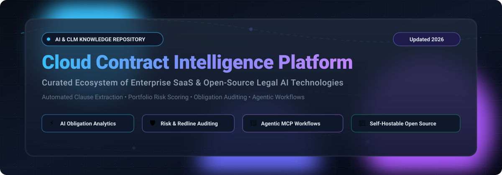

  

# ⚡ Awesome Cloud Contract Intelligence Platform

### 🚀 A Curated Knowledge Base & Landscape of Enterprise SaaS and Open-Source Legal AI Ecosystems
*Transforming static legal documents and executed master agreements into proactive, searchable, and auditable business intelligence with LLMs, NLP, and Agentic Workflows.*

---

## 📖 Introduction & Repository Focus

Welcome to the **Awesome Cloud Contract Intelligence Platform** directory—the ultimate guide for legal operations professionals, enterprise procurement teams, corporate counsels, and developers building modern contract intelligence architectures.

Traditional **Contract Lifecycle Management (CLM)** historically functioned as passive document repositories and rigid workflow orchestrators. Today, **AI-Powered Contract Intelligence Platforms** leverage Large Language Models (LLMs), Natural Language Processing (NLP), and multi-agent workflows to:
- 🔍 **Automate Key Term & Clause Extraction**: Accurately detect indemnities, liabilities, SLA obligations, renewal windows, governing law, and payment schedules.
- 🛡️ **Score Portfolio-Wide Risk & Compliance**: Benchmark agreements against internal negotiation playbooks and international regulatory baselines (GDPR, HIPAA, DORA).
- ⚡ **Drive Agentic Contract Review & Redlining**: Deploy AI copilots directly inside Microsoft Word and Google Docs to suggest lawyer-ready redlines and audit deviations.
- 📊 **Track Post-Signature Obligations**: Surface milestone deadlines, auto-renewal triggers, and performance deliverables with page-level citations.

---

## 📑 Table of Contents
- [🌐 Sector Overview & Market Dynamics](#-sector-overview--market-dynamics)
- [🏢 Enterprise SaaS & Hosted Platforms](#-enterprise-saas--hosted-platforms)
- [🔓 Open-Source GitHub Projects](#-open-source-github-projects)
- [🏗️ Building a Custom Open-Source Intelligence Stack](#%EF%B8%8F-building-a-custom-open-source-intelligence-stack)
- [🤝 How to Contribute](#-how-to-contribute)
- [💖 Support & Sponsorship](#-support--sponsorship)
- [📈 Star History](#-star-history)
- [⚠️ Disclaimer](#%EF%B8%8F-disclaimer)

---

## 🌐 Sector Overview & Market Dynamics

The global Contract Lifecycle Management (CLM) and Contract Intelligence software market is valued between **$2.0 billion and $3.68 billion in 2026** (scaling steadily from ~$1.8B–$3.2B in 2025) and is compounding at an estimated **11.5% to 14.2% CAGR**. The specialized AI-powered contract analytics and risk intelligence sub-segment is outpacing the broader sector at **>20% YoY**.

### 🧩 Market Concentration vs. Fragmentation
The industry is **highly fragmented yet experiencing aggressive multi-front consolidation**:
* **Enterprise Mega-Suites vs. AI Specialists**: Broad enterprise business suites (Workday via Evisort, DocuSign via Lexion, RELX/LexisNexis) compete aggressively alongside multi-billion dollar dedicated CLM leaders (Icertis, Ironclad, Conga) and fast-moving AI-native startups.
* **No Winner-Take-All Monopoly**: Due to varying departmental buyer personas (Legal vs. Procurement vs. Sales Ops) and deep ERP/CRM ecosystem entanglements (SAP, Salesforce, Microsoft 365), no single vendor captures a dominant majority.
* **High Churn & Replacement Velocity**: Over 40% of organizations replace their initial contract management solution within 36 months, primarily driven by legacy onboarding friction and data readiness hurdles when adopting advanced AI models.

---

## 🏢 Enterprise SaaS & Hosted Platforms

*Below is a comprehensive comparison of leading commercial Contract Intelligence and CLM suites, sorted in descending order by parent company scale (valuation or market cap).*

| Product | 🏢 Company Scale (Valuation / Revenue) | 📝 Description | 💳 Pricing (Starting) | 🎁 Free Tier / Trial Limits |
|:---|:---|:---|:---|:---|
| **[Summation (RELX / LexisNexis)](https://www.lexisnexis.com/)** | **~$70 Billion Market Cap** (RELX Group: ~$12.5B+ annual revenue; LexisNexis Legal division ~$2B+ revenue) | Enterprise litigation review, transcript management, and document discovery platform by LexisNexis, increasingly paired with Lexis+ AI for portfolio document analysis. | **$125/user/month** (entry LexisNexis legal document review suite starting tier; enterprise discovery contracts scale to $25,000+/year) | **7-day free trial** available via sales rep request for verified corporate legal/firm email addresses; no permanent free tier |
| **[Evisort (Workday)](https://www.evisort.com/)** | **~$48 Billion Market Cap** (Workday parent: $9.55B FY2026 revenue; Evisort acquisition ~$250M) | AI-powered CLM and contract intelligence platform acquired by Workday in 2024 (Workday Contract Lifecycle Management). REST API supports document intake, clause extraction, portfolio risk search, and automated workflows. | **$30,000/year** (starting base tier for small teams, processing 500–2,000 contracts/year; mid-market packages run $60,000–$120,000/year) | **14-day free trial** with self-serve try-now access (contract upload limits capped at 25 documents during trial); no permanent free tier |
| **[Lexion (Docusign)](https://www.lexion.ai/)** | **~$15 Billion Market Cap** (DocuSign parent: ~$3.2B FY2026 revenue; Lexion acquired for $165M in May 2024) | AI-powered CLM and intake automation folded into Docusign IAM (Intelligent Agreement Management) and Navigator for automated clause and obligation extraction. | **$15,000/year** (baseline entry tier for small legal teams via Vendr benchmark; median contract sits at $29,600/year; DocuSign eSign entry is $10/user/month) | **No self-serve free trial** (sales-assisted guided pilot of 14–30 days granted to qualified enterprise accounts upon demo); no permanent free tier |
| **[Icertis](https://www.icertis.com/)** | **$5.0 Billion Valuation** (~$350M ARR; backing from SoftBank, B Capital, and PremjiInvest) | Enterprise AI-native contract intelligence platform powered by Vera conversational AI, covering pre-signature drafting, post-signature obligation compliance, and portfolio risk analysis. Used by >35% of the Fortune 100. | **$100,000/year** (entry minimum enterprise contract value; typical deployments range $100K–$500K+/year plus implementation services) | **No free trial** (guided proof-of-concept POCs arranged strictly via enterprise sales engagement; 0-day self-serve trial); no permanent free tier |
| **[Conga CLM](https://www.conga.com/)** | **~$3.5 Billion Valuation** (~$400M+ revenue; private equity owned by Thoma Bravo) | End-to-end CLM built on the Conga Revenue Lifecycle Platform. Centralizes agreement repositories, automates approvals, redlines via AI, and tracks commitments across Salesforce and ERPs. | **$35/user/month** (starting price for modular AppExchange seat license; full CLM platform packages average $17,000–$45,000/year) | **30-day free trial** available through Salesforce AppExchange for Conga review & Composer modules; no permanent free tier |
| **[Ironclad](https://ironcladapp.com/)** | **$3.2 Billion Valuation** (Series E; ~$150M+ ARR; backed by Accel, Sequoia, and Franklin Templeton) | Modern digital contracting and CLM platform featuring Ironclad Agent, playbook redlining, and an official MCP server for agentic AI integration. Gartner MQ & Forrester Wave CLM Leader. | **$40,000/year** (mid-market starting contract tier via Vendr benchmark; scales upwards of $120,000+/year for enterprise volumes) | **No public self-serve free trial** (custom 14-day proof-of-concept pilot available exclusively through sales team for qualified enterprise evaluations); no permanent free tier |
| **[ContractPodAi](https://contractpodai.com/)** | **~$350 Million Valuation** (~$35M–$50M ARR; backed by $115M Series C from SoftBank Vision Fund 2) | Enterprise legal AI platform centered on Leah, an agentic legal AI assistant for automated playbook redlining, deep contract clause discovery, and cross-portfolio risk scoring. | **$50,000/year** (starting baseline deployment fee; mid-tier enterprise agreements range from $65,000 to $150,000/year) | **No free trial** (interactive sandbox walkthrough and custom sales-led POC only; 0-day public trial); no permanent free tier |
| **[Sirion](https://www.sirion.ai/)** | **~$300 Million Valuation** (~$75M ARR; $182M total funding from Tiger Global, Sequoia India, Haveli) | AI-native CLM specialized in large enterprise buy-side and sell-side agreements, managing over 7M+ contracts worth ~$800B with deep obligation fulfillment and invoice-reconciliation intelligence. | **$50,000/year** (starting enterprise platform tier; billed on named-user tiering for power legal editors vs. casual viewers) | **No free trial** (evaluations conducted exclusively via custom enterprise sandbox demos; 0-day self-serve trial); no permanent free tier |
| **[CobbleStone Software](https://www.cobblestonesoftware.com/)** | **~$150 Million Valuation** (~$26.5M ARR; bootstrapped & self-sustained profitable private company) | Comprehensive CLM and eProcurement platform (CobbleStone Contract Insight) with VISDOM AI engine for clause recognition, risk rating, compliance alerts, and IntelliSign e-signatures. | **$59/user/month** (starting base tier for Contract Insight Core edition; enterprise on-premise/cloud packages scale with custom add-ons) | **30-day free trial** with full access to standard CLM workflow configuration and document generation; no permanent free tier |
| **[Agiloft](https://www.agiloft.com/)** | **~$120 Million Valuation** (~$45M ARR; backed by $45M growth investment from FTV Capital) | Data-first configurable CLM and contracts AI suite. Features Agiloft Astra for agentic AI contract review, obligation extraction, and risk identification directly inside Microsoft Word. | **$120/month** (Agiloft Astra AI Pro starting plan; core enterprise CLM platform starts at $68,000/year via Vendr benchmark) | **Agiloft Astra Free Tier**: Permanent free plan including Astra Microsoft Word add-in, contract analysis, and Clean Data Promise with monthly usage credit quotas; 0-cost onboarding |

---

## 🔓 Open-Source GitHub Projects

*Self-hosted contract intelligence, AI-assisted clause review, and modern CLM repositories sorted in descending order by GitHub stargazers count. Every star badge links directly to that repository's stargazers page.*

| Project | ⭐ Stars | 📝 Description | 🎯 Focus Area |
|:---|:---:|:---|:---|
| **[DocuSeal](https://github.com/docusealco/docuseal)** |  | Open-source platform for providing secure digital signatures, document field verification, automated PDF processing, and mobile-friendly signing workflows. | ✍️ Document Signing & Execution |
| **[Documenso](https://github.com/documenso/documenso)** |  | Modern, open-source digital signing infrastructure designed to be embedded into any contract workflow or self-hosted agreement stack via comprehensive REST/GraphQL APIs. | 🔐 Document Signing Infrastructure |
| **[OpenSign](https://github.com/OpenSignLabs/OpenSign)** |  | Free and open-source DocuSign alternative offering document signing, automated signer sequencing, PDF template builders, compliance audit trails, and REST API/webhooks. | 📜 e-Sign & Document Workflows |
| **[ai-legal-claude](https://github.com/zubair-trabzada/ai-legal-claude)** |  | Multi-agent legal intelligence skill suite for Claude Code. Features 14 modular skills and 5 parallel agents for contract review, risk analysis, playbook redlining, and compliance auditing. | 🤖 Agentic Contract Review & Redlining |
| **[OpenContracts](https://github.com/Open-Source-Legal/OpenContracts)** |  | Open-source document intelligence and contract analysis platform. Provides layout-aware PDF ingestion, clause extraction, semantic vector search, and annotation interfaces for large contract archives. | 📑 Portfolio Contract Analytics & Extraction |
| **[CUAD](https://github.com/The-Atticus-Project/cuad)** |  | Contract Understanding Atticus Dataset (NeurIPS) and model benchmarks curated by legal experts. Serves as the foundational open-source benchmark for evaluating AI models across 41 critical contract clause types. | 📊 Legal AI Benchmark & Dataset |
| **[claude-legal-skill](https://github.com/evolsb/claude-legal-skill)** |  | AI-powered contract review skill with CUAD-based risk identification, market benchmark comparisons, and lawyer-ready redline generation across Claude, Cursor, and Codex. | 🛡️ Automated Contract Auditing & Redlining |
| **[Accord Project Template Archive](https://github.com/accordproject/template-archive)** |  | Open-source ecosystem of machine-readable smart legal contract templates and natural language specifications developed by the Linux Foundation's Accord Project. | 🏛️ Smart Legal Templates & Logic |
| **[Accord Project Concerto](https://github.com/accordproject/concerto)** |  | Portable, schema modeling language and runtime for legally enforceable agreement data models, runtime validation, and structured contract clause representation. | 🧬 Contract Data Modeling & Schemas |
| **[Vaquill MS Word Legal Assistant](https://github.com/Vaquill-AI/ms-word-addin)** |  | Open-source MS Word plugin for legal teams. Delivers AI contract review, negotiation playbook execution, redline generation, and clause drafting directly in Microsoft Word. | 📝 In-Editor Contract Review & Redline |
| **[draftLegal](https://github.com/AniketTati/draft-legal)** |  | Self-hosted, AI-native CLM positioned as an open-source Ironclad + Harvey alternative. Features ~30 tools over agreements, hybrid vector search (pgvector + Elasticsearch), and BYO LLM key deployment. | 💻 Self-Hosted AI CLM |
| **[Aakd](https://github.com/aaked-app/aakd)** |  | Self-hosted contract intelligence tool focused on post-signature obligation management. Extracts obligations with source citations, manages fulfillment deadlines, and exposes REST & MCP agent endpoints. | ⏰ Post-Signature Obligation Intelligence |
| **[OpenCLM](https://github.com/bytecrunch-io/openclm)** |  | Self-hostable, modern open-source contract lifecycle management platform with collaborative redlining, review workflows, electronic signatures, and API-first contract storage. | 📦 End-to-End Open-Source CLM |

---

## 🏗️ Building a Custom Open-Source Intelligence Stack

You can combine these modular open-source projects into an enterprise-grade contract intelligence pipeline without vendor lock-in or recurring SaaS per-seat costs:
1. 🏛️ **Contract Modeling & Schema Standardization**: Use **Accord Project Concerto & Template Archive** to define validated contract schemas and standardized legal language.
2. ✍️ **Execution & Ingestion**: Pair **DocuSeal**, **Documenso**, or **OpenSign** for zero-cost electronic signature workflows and PDF certificate generation.
3. 🧠 **AI Extraction & Portfolio Search**: Deploy **OpenContracts** for portfolio-wide PDF ingestion and vector search, alongside **draftLegal** or **ai-legal-claude** for automated playbook compliance checks and clause extraction.
4. ⏰ **Post-Signature Obligation Intelligence**: Deploy **Aakd** for source-linked obligation tracking, milestone alerts, and agentic Model Context Protocol (MCP) tool connections.

---

## 🤝 How to Contribute

Contributions are warmly encouraged! Here is how you can help expand this community resource:
1. 🍴 Fork the repository.
2. 🌿 Create your feature branch (`git checkout -b feature/add-new-platform`).
3. 📝 Add your entry into `README.md` adhering to the table format (include official links, pricing, free tier terms, and star badges).
4. 💡 Commit your changes with a descriptive message (`git commit -m 'feat: Add NewPlatform to open-source section'`).
5. 🚀 Push to the branch (`git push origin feature/add-new-platform`) and open a Pull Request.

---

## 💖 Support & Sponsorship

Thank you so much for exploring and using this repository! If this resource saved you time, helped you evaluate a contract intelligence system, or assisted in building your open-source legal stack, please consider supporting the project:

- ⭐ **Star this repository** to help others discover it on GitHub.
- 🍴 **Fork and share** it with your legal engineering, procurement, and developer peers.
- 💬 **Join our community on Discord** to discuss contract intelligence pipelines and AI legal engineering.
- ☕ **Support future maintenance and buy a coffee** directly through our **[GitHub Sponsors Dashboard](https://github.com/sponsors/ishandutta2007)**!

Your support keeps this directory up-to-date with active market research and new open-source tooling.

---

## 📈 Star History

---

## ⚠️ Disclaimer

- 📌 This repository is a **community-curated** landscape and does not constitute formal legal, procurement, or financial advice.
- 🔒 Contract intelligence platforms frequently process highly sensitive commercial, financial, and personal data. Always enforce stringent data access controls, audit logging, and ensure compliance with applicable data privacy regulations (e.g., GDPR, CCPA, HIPAA).
- ⚖️ Self-hosted open-source solutions require independent validation of AI-assisted extraction accuracy before relying on automated fields; human review remains critical for legal and financial commitments.

---

**Made with ❤️ for legal operations teams, contract managers, procurement professionals, and AI legal engineers.**  
*Let's make contract intelligence more open, accurate, auditable, and automated.*

